# Дзюкурэн: гайд по функциям

**Дзюкурэн (熟練)** — календарь, который помнит за тебя, и путь мастера, который растёт из того, что ты реально делаешь. Приложение для Windows, все данные лежат только у тебя на компьютере, язык один — русский.

Идея в трёх шагах:

1. **Запланируй.** Событие в календаре — это квест: тренировка, чтение, звонок. В нужный момент выскакивает окно.
2. **Отметь.** «Выполнено» записывает дело в журнал: что, когда, сколько минут. Журнал — единственный источник правды.
3. **Расти.** Из журнала считаются опыт, серии и открытые узлы дерева. Штрафов по умолчанию нет: пропуск ничего не отнимает. Строгий режим включается отдельно (раздел «Эксперт»).

> Все снимки сделаны на демо-данных вымышленного персонажа Хиро.

## Оглавление

1. [Установка и первый запуск](#1-установка-и-первый-запуск)
2. [Мастер создания персонажа](#2-мастер-создания-персонажа)
3. [Календарь и напоминания](#3-календарь-и-напоминания)
4. [Сегодня](#4-сегодня)
5. [Привычки](#5-привычки)
6. [Древо умений](#6-древо-умений)
7. [Пути: свой план через нейросеть](#7-пути-свой-план-через-нейросеть)
8. [Освоено до старта: калибровка, шаблоны, пресеты, свои достижения](#8-освоено-до-старта)
9. [Экспертный режим](#9-экспертный-режим)
10. [Звуки](#10-звуки)
11. [Данные: экспорт и импорт](#11-данные-экспорт-и-импорт)
12. [Что ещё не готово](#12-что-ещё-не-готово)

---

## 1. Установка и первый запуск

- Скачай `Setup 0.x.x.exe` со страницы [Releases](https://github.com/Misurugi/dzyukuren/releases) и запусти. Права администратора не нужны: приложение ставится в профиль пользователя.
- Установщик не подписан цифровой подписью, поэтому Windows может показать предупреждение SmartScreen. «Подробнее» → «Выполнить в любом случае».
- Приложение сворачивается в трей и запускается вместе с Windows (скрыто), чтобы напоминания приходили, даже когда окно закрыто. Закрыть совсем — «Выход» в меню значка в трее.
- Данные лежат в `%APPDATA%\dzyukuren\dzyukuren.db`. Интернет приложению не нужен (он потребуется только для открытия этого гайда).
- Кнопка **«?»** в шапке окна открывает этот гайд в браузере.

## 2. Мастер создания персонажа

При самом первом запуске поверх экрана «О приложении» открывается мастер из пяти шагов. Его можно пройти заново в любой момент кнопкой «Пройти мастер заново» на вкладке «О приложении» или нажатием на своё имя в шапке.

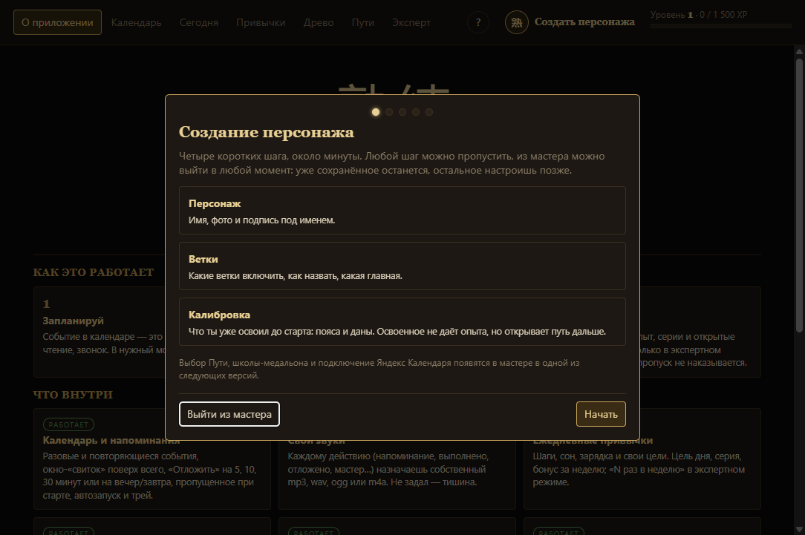

**Персонаж.** Имя, подпись и фото (необязательно, фото сжимается до 256 пикселей и хранится только у тебя). Имя и подпись показываются в шапке рядом с уровнем.

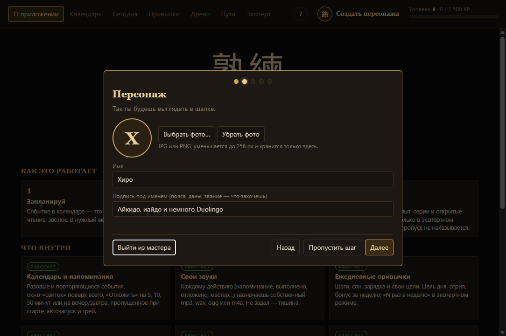

**Ветки.** Пять ветвей развития: **Сила**, **Ловкость**, **Интеллект**, **Мудрость**, **Круг**. Каждую можно выключить, переименовать (до 24 символов) и выбрать главную ★: она показывается первой. Выключенная ветка просто скрыта, её прогресс не теряется.

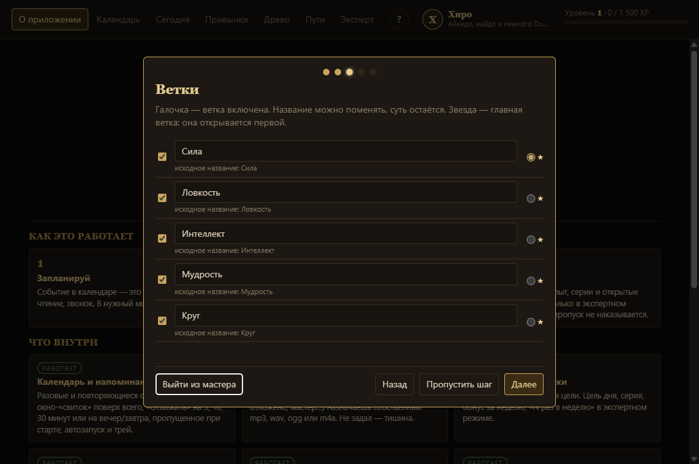

**Калибровка** — что ты уже освоил до приложения. Подробно в [разделе 8](#8-освоено-до-старта).

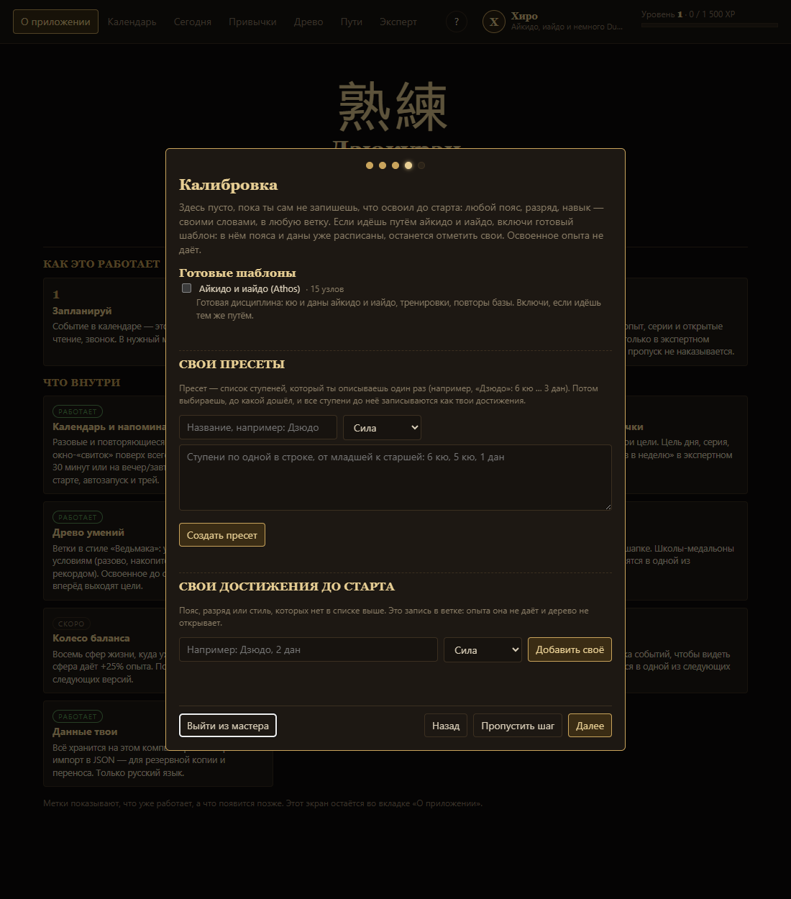

**Готово.** Сводка по персонажу. Дальше открывается «Сегодня».

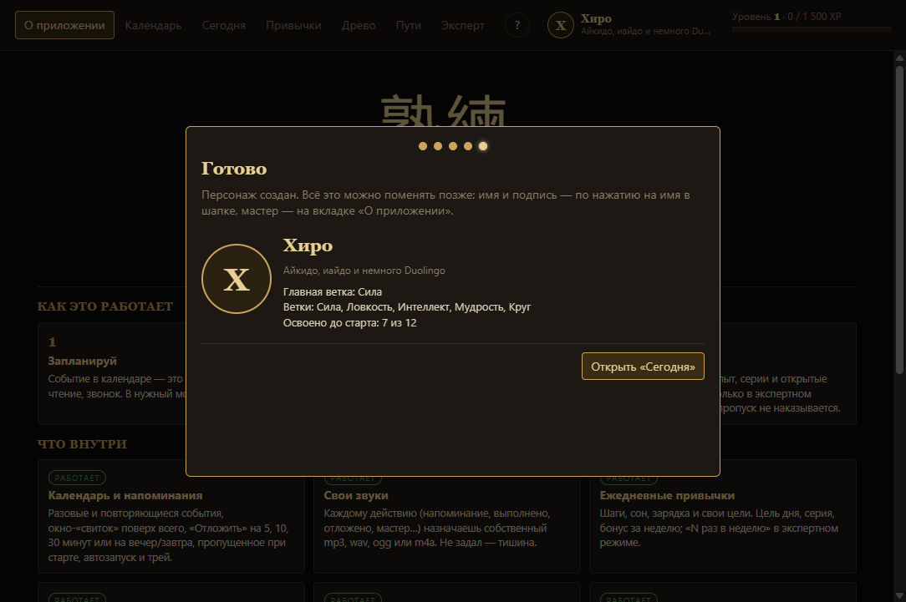

Любой шаг можно пропустить, а из мастера выйти: он повторно сам не откроется.

## 3. Календарь и напоминания

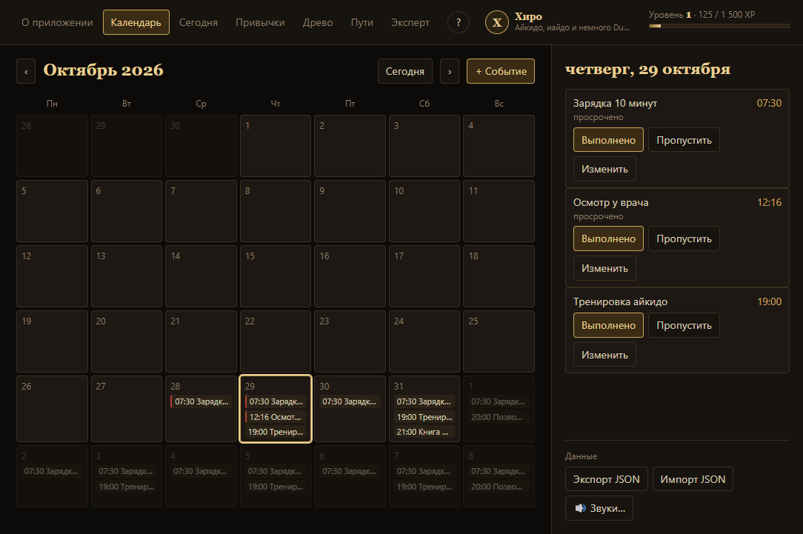

- **Месяц** слева, события дня и данные справа. «Сегодня» возвращает к текущему дню, стрелки листают месяцы.
- **«+ Событие»** — название, дата, время, повтор, заметка. Повтор: разовое, каждый день или по дням недели (например, вт/чт/сб).
- **Привязка к узлу дерева.** Если выбрать узел, событие становится квестом: за выполнение дают опыт (по умолчанию 10, от 0 до 1000). Поле опыта появляется, только когда узел выбран.
- Тип отметки: «сделал», «число» (например, повторов) или «минуты». Число и минуты записываются в журнал и нужны условиям узлов.

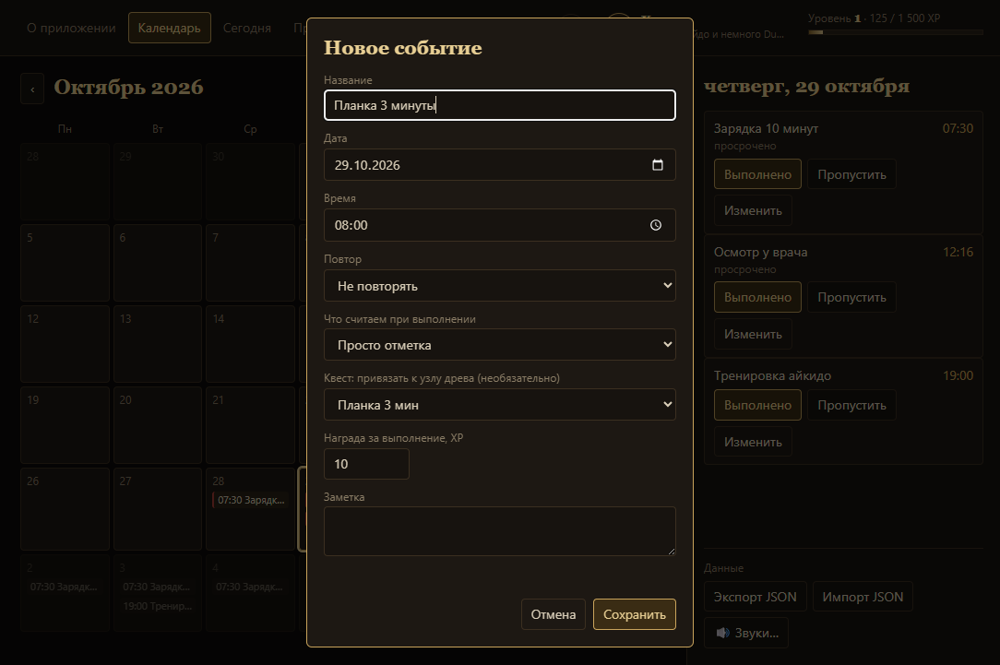

### Окно «Пора»

В назначенное время поверх всех окон выскакивает окно-«свиток». Если приложение было закрыто, а напоминание пропущено, оно покажется при запуске с пометкой «пропущено».

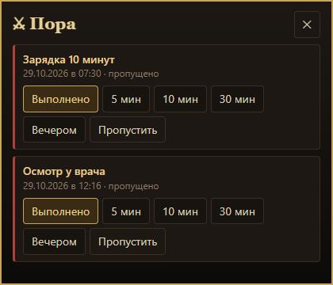

- **Выполнено** — запись в журнал (для числа и минут сначала надо ввести значение).
- **5 / 10 / 30 мин** — отложить. **Вечером** — отложить на вечер; после 18:00 вместо неё кнопка **Завтра**.
- **Пропустить** — событие пропущено. Без экспертного режима это ничего не отнимает.

## 4. Сегодня

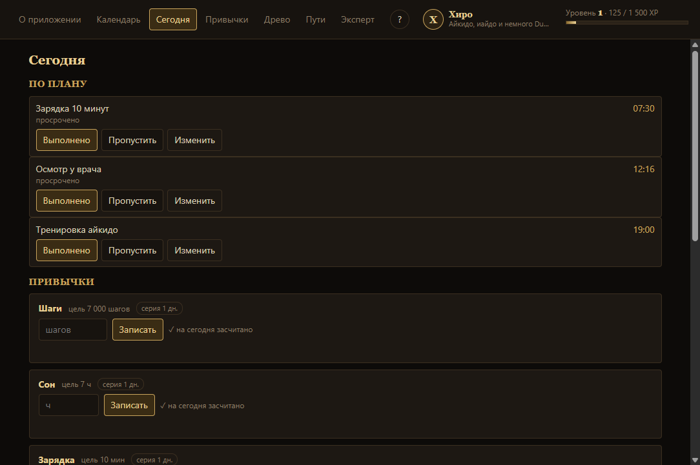

Одна страница на день: сверху события «по плану» с теми же кнопками, ниже привычки с полями ввода. Закрыл всё — день прожит.

## 5. Привычки

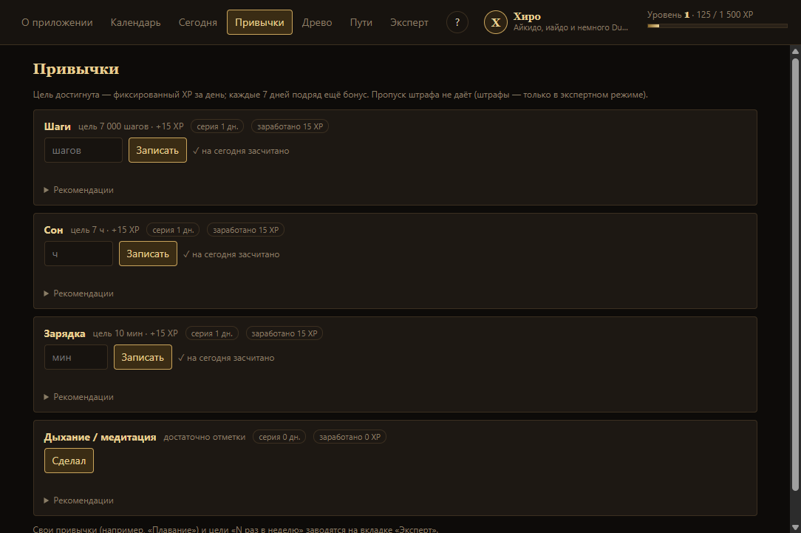

Четыре привычки из коробки с целями по умолчанию: **Шаги** (7 000), **Сон** (7 часов), **Зарядка** (10 минут), **Дыхание / медитация** (достаточно отметки). Вводишь значение, цель дня достигнута — начисляется фиксированный опыт за день, и растёт серия дней подряд. Каждые 7 дней подряд даёт ещё бонус. Под каждой привычкой есть раскрывающиеся рекомендации.

Пропуск привычки штрафа не даёт. Свои привычки и цели вида «N раз в неделю» заводятся на вкладке «Эксперт».

## 6. Древо умений

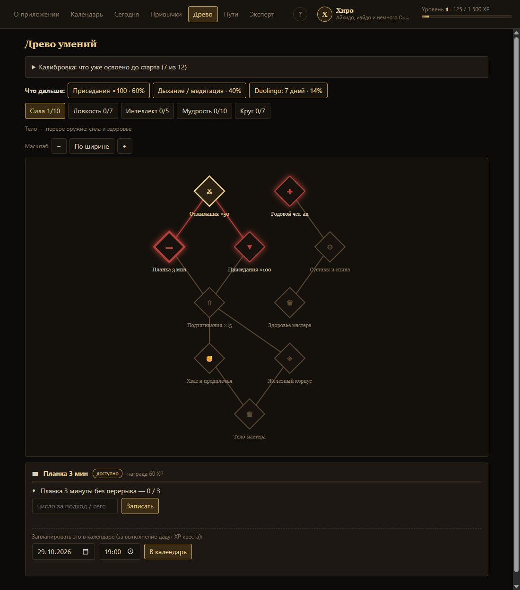

Вверху вкладки:

- **Калибровка** — свернутый блок (раздел 8).
- **Что дальше** — до трёх доступных узлов, по которым прогресс уже идёт. Нажатие переносит к узлу.
- **Фильтр веток** с числом освоенных узлов. Выключенные в мастере ветки не показываются.
- **Масштаб** схемы: «−», «+» и «По ширине» (вписать в окно).

### Узлы

Каждый узел — ромб на схеме. Его состояние:

| Вид | Что значит |
|---|---|
| тусклый | **закрыт**: не освоены родители (линии сверху) |
| со свечением цвета ветки | **доступен**: можно двигаться к нему |
| золотой | **освоен**; освоенное не откатывается |

Родитель освоен — открывается ребёнок. Нажми на узел, откроется карточка с условиями, прогрессом и наградой в опыте. Внизу карточки:

- Поле для записи результата («число за подход / серо»): например, 50 отжиманий за подход.
- **Запланировать** — создаёт событие в календаре с привязкой к узлу, чтобы квест напомнил о себе сам. Дубль не создаётся: если событие уже есть, карточка так и скажет.

Освоенный узел проигрывает анимацию (если в Windows не включено «уменьшить движение»).

### Условия узлов

| Условие | Пример |
|---|---|
| отметить вручную | «Прочитать Мусаси» |
| сумма за период | «100 приседаний за день», «26 занятий за 3 месяца» |
| серия | «7 дней подряд», «4 недели подряд» |
| рекорд за подход | «50 отжиманий за подход» |
| серия привычек | «Сон, Шаги и Зарядка: 30 дней без перерыва» |
| баланс сфер | запланировано: ждёт колеса баланса |

Узел «Повтор базы» (круговая стрелка) — освежить навык: подтверди, что навык держишь.

### Уровень

Опыт копится за освоенные узлы, выполненные квесты и привычки. Каждые **1 500 XP** — новый уровень. Шкала уровня в шапке справа.

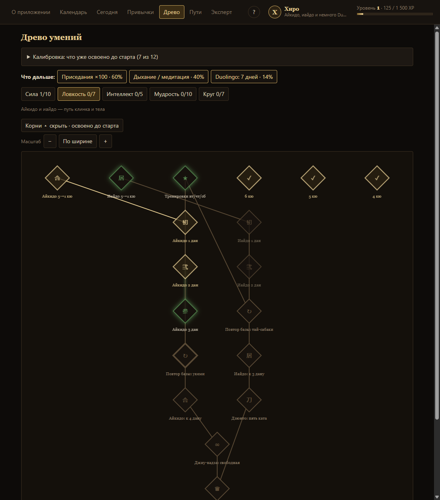

## 7. Пути: свой план через нейросеть

Вкладка **«Пути»**. Путь — это набор дисциплин с узлами для дерева и разовыми делами. Ты описываешь цель («выучить испанский с нуля»), нейросеть составляет план, приложение проверяет его и добавляет в дерево. Работает без интернета и без ключей: нейросеть — любая, с которой ты общаешься в чате.

### Через чат (обычный способ)

1. Напиши в поле, что хочешь освоить, и нажми **«Скопировать запрос»**. Приложение соберёт полный запрос: жёсткие правила («не задавай вопросов, всё неясное — в допущения, ответь только JSON»), твою цель, пример ответа и справочник по веткам и условиям.
2. Вставь запрос в чат с нейросетью. Ответ скопируй целиком.
3. Вставь ответ в поле «2» и нажми **«Проверить ответ»**. Пояснения вокруг JSON не мешают: приложение вынет его само.

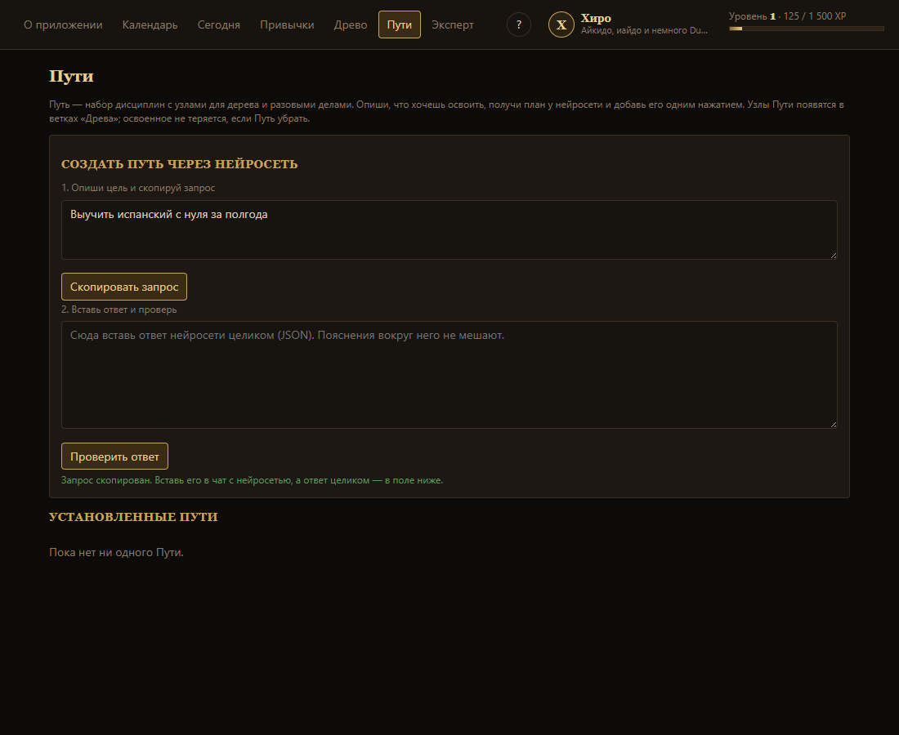

4. Появится **предпросмотр**: допущения нейросети, дисциплины с узлами (награда, условие, что нужно освоить раньше) и вкладка «Список дел». Ничего не добавлено, пока ты не нажмёшь **«Добавить Путь»**.

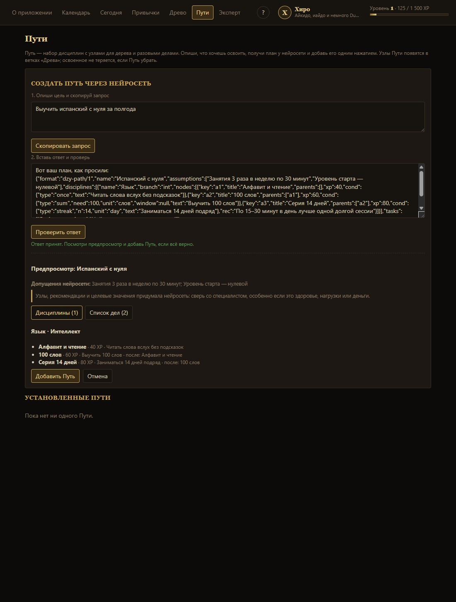

Если нейросеть ответила не JSON, а обычным планом с оговорками, приложение так и скажет и предложит **«Скопировать запрос на преобразование»**: отправь его той же нейросети, и она переложит свой план в нужный формат.

### Что проверяется

Ответ нейросети считается недоверенными данными. Приложение отвергает ответ с понятной причиной, если:

- нет дисциплин, их больше 5 или узлов больше 60;
- ветка не из списка, у узла нет названия, условия или награды (0–1000 XP целым);
- родитель не найден, родители замкнуты в круг или указан узел из другой дисциплины;
- условие не из четырёх видов: разовая отметка, накопление, серия, рекорд;
- в тексте есть теги, HTML, ссылки или управляющие символы.

Значки узлов, номера и расположение назначает приложение, а не нейросеть. Рекомендации и целевые значения пометятся «сверь со специалистом»: на карточке такого узла в дереве написано, что он придуман нейросетью.

### Установленные Пути

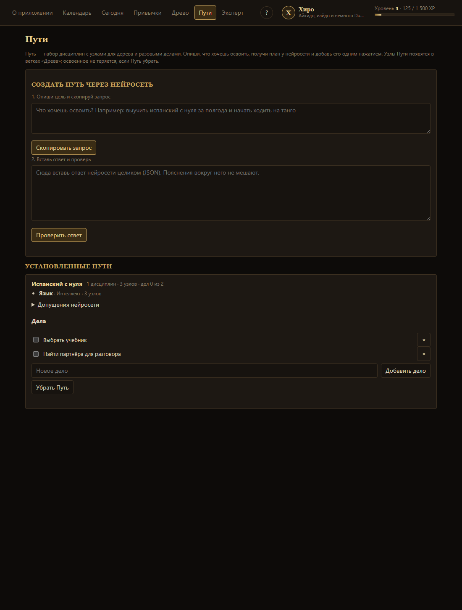

Узлы Пути появляются в нужных ветках дерева и осваиваются как обычные: опыт, серии, «Что дальше».

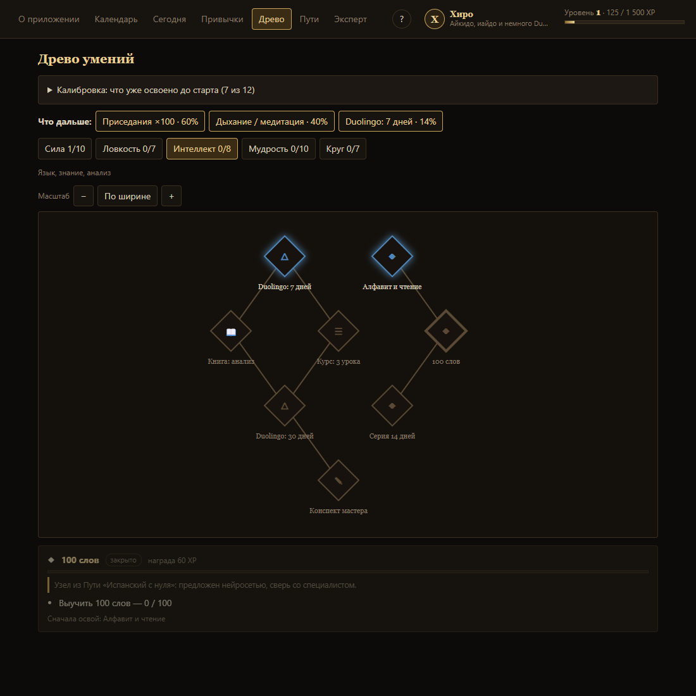

На карточке Пути:

- **Дела** — разовые дела без сроков и без опыта (купить учебник, найти партнёра). Отмечай галочкой, добавляй свои (до 100, без дублей), удаляй крестиком.
- **Допущения нейросети** — что она решила за тебя.
- **Убрать Путь** — с подтверждением вторым нажатием. Узлы пропадут вместе с Путём и перестанут считаться в уровне, но запись об освоенном сохранится в журнале. До 10 Путей, названия не повторяются.

Пока ответ не добавлен, он хранится только в открытом окне, и если уйти на другую вкладку, поля не потеряются.

### По API (экспертный режим)

Если не хочется копировать вручную, в экспертном режиме включается отправка запроса напрямую (раздел 9). Тогда на вкладке «Пути» рядом с «Скопировать запрос» появляется **«Спросить нейросеть (API)»**. Перед отправкой открывается окно с полным текстом запроса, адресом и моделью: ты видишь всё, что уйдёт. «Отправить» отправляет, «Отмена» закрывает. Ответ проверяется так же, как вставленный вручную, и показывается предпросмотр.

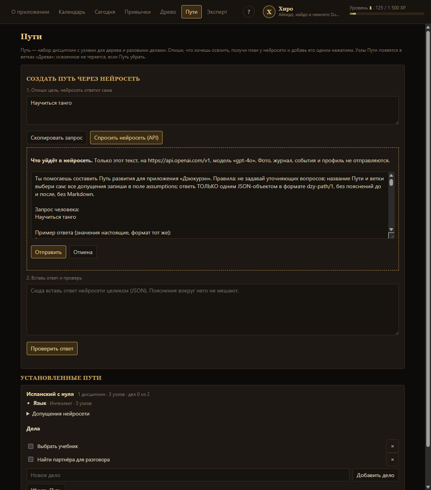

## 8. Освоено до старта

Раньше ты тренировался, учил язык, читал. Как не начинать с нуля? Четыре инструмента, все лежат в блоке «Калибровка» вкладки «Древо» и на шаге «Калибровка» мастера. **Освоенное до старта опыта не даёт.**

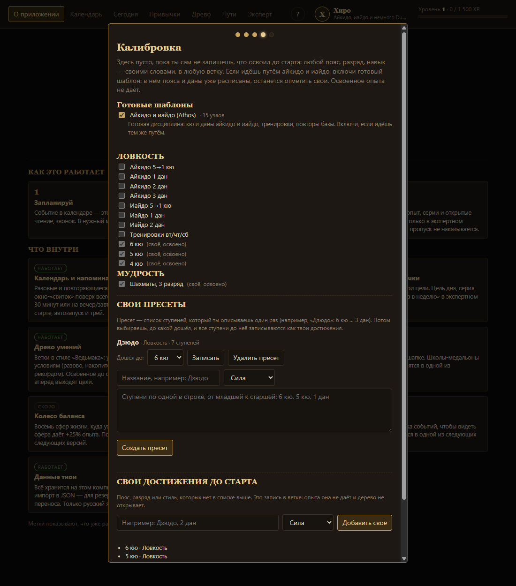

### Свои достижения

Любой пояс, разряд, навык своими словами в любую ветку: название (до 60 символов) и ветка. Запись рисуется на схеме освоенным корнем ветки. Это именно запись: дерево она не открывает. Всего до 30 записей, дубль в одной ветке отвергается. Удалить запись можно на её карточке в дереве.

### Шаблоны

Готовая дисциплина с узлами дерева. Сейчас есть один: **«Айкидо и иайдо (Athos)»** — вся ветка «Ловкость»: кю и даны айкидо и иайдо, тренировки, повторы базы, 15 узлов. По умолчанию выключен. Включил — в «Ловкости» появляются узлы, и можно отметить свои пояса: **старшая ступень тянет младшие** (отметил 3 дан — освоены 1 и 2 дан и кю). Выключил — узлы скрываются, а освоенное хранится и вернётся при включении. Пока шаблон выключен, его опыт в уровень не входит.

### Свои пресеты

Если твоя дисциплина не айкидо, опиши её один раз. Пресет — это название, ветка и ступени по порядку от младшей к старшей (по одной в строке, до 30). Например, «Дзюдо»: 6 кю, 5 кю, … 1 дан. Потом выбираешь «Дошёл до: 4 кю» и жмёшь «Записать»: ступени с первой до выбранной записываются как твои достижения. Повторная запись ничего не задваивает. Удалили пресет — записанные достижения остаются. Пресет узлов дерева не создаёт.

### Калибровка корней

Для включённых шаблонов в списке есть чекбоксы корней: отметил, нажал «Применить калибровку», и корень с его предками освоены. Игровые узлы так не отметить: их осваивают только делом.

## 9. Экспертный режим

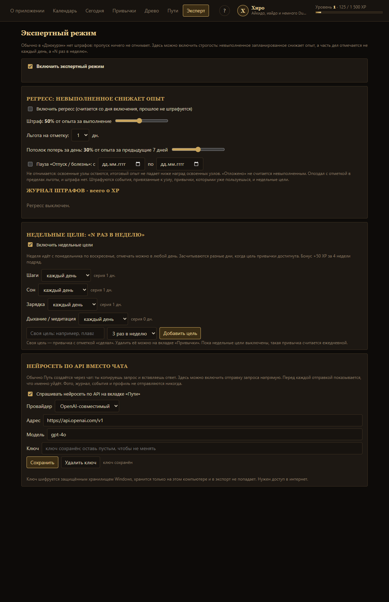

По умолчанию штрафов нет. Здесь включается строгий режим (общий выключатель, а внутри отдельные):

- **Регресс** — невыполненное запланированное снижает опыт. Считается со дня включения, прошлое не штрафуется. Настраиваются доля штрафа (по умолчанию 50% от награды), льгота на отметку (1 день), потолок потерь за день (30% от опыта за предыдущие 7 дней) и пауза «Отпуск / болезнь». Освоенные узлы остаются, итоговый опыт не падает ниже наград освоенных узлов. «Отложено» не считается невыполненным. В журнале штрафов каждый штраф можно простить.
- **Недельные цели** — привычка «N раз в неделю» вместо ежедневной; неделя с понедельника по воскресенье, бонус +50 XP за 4 недели подряд. Здесь же заводятся свои привычки (например, «Плавание»).
- **Нейросеть по API вместо чата** — отправка запроса на создание Пути напрямую. Поддерживаются два вида: OpenAI-совместимый (адрес вида `https://api.openai.com/v1`, подходят и другие сервисы и локальные модели) и Anthropic. Задаются провайдер, адрес, модель и ключ доступа. Адрес должен быть `https`, для локальной модели допустим `http://localhost`. Ключ шифруется защищённым хранилищем Windows, лежит только на этом компьютере, не попадает в экспорт и обратно в окно не показывается; удалить его можно кнопкой «Удалить ключ». Уйдёт только текст запроса, который ты видишь перед отправкой. Фото, журнал, события и профиль не отправляются никогда. Нужен интернет. Сервис нейросети может взять плату по своему тарифу.

## 10. Звуки

Кнопка «🔊 Звуки…» на вкладке «Календарь».

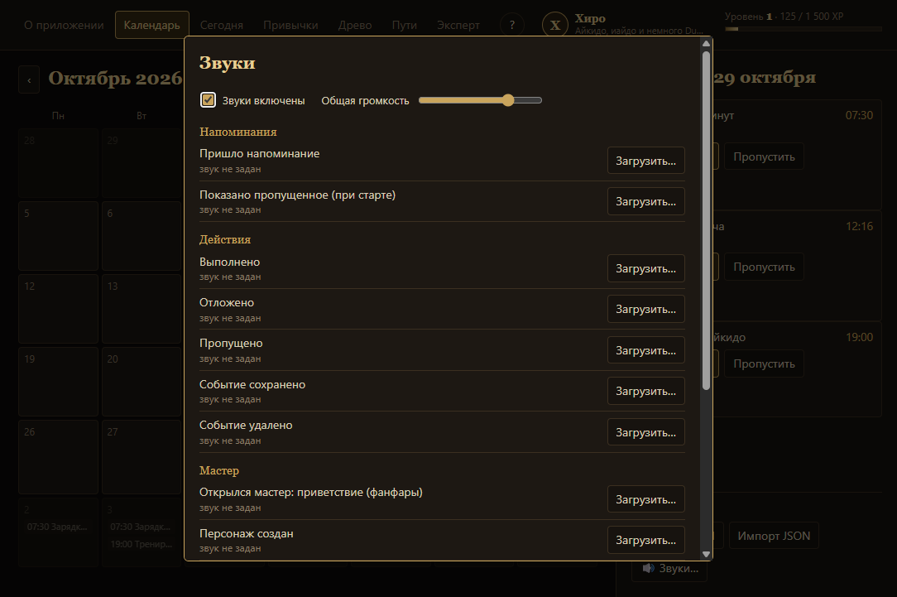

Двенадцать моментов, каждому можно назначить свой файл (mp3, wav, ogg или m4a), громкость и предпрослушку: пришло напоминание, показано пропущенное, выполнено, отложено, пропущено, событие сохранено или удалено, приветствие мастера (фанфары), персонаж создан, экспорт или импорт, ошибка, любая другая кнопка. Пока файл не задан, будет тишина: приложение ничего не навязывает.

## 11. Данные: экспорт и импорт

Кнопки «Экспорт JSON» и «Импорт JSON» справа на вкладке «Календарь». В файл идут события, журнал, освоенные узлы, настройки, профиль, ветки, выбор шаблонов, пресеты и свои достижения. Импорт заменяет все текущие данные целиком, перед этим приложение спрашивает подтверждение и сначала проверяет файл: если он повреждён или новее приложения, ничего не изменится. Файлы прежних версий читаются.

Экспорт — единственный способ переноса на другой компьютер и резервная копия. Делай его время от времени.

## 12. Что ещё не готово

На вкладке «О приложении» это помечено «Скоро»:

- **Колесо баланса** — восемь сфер жизни; даст «Здоровье мастера» и «Круг мастера» в дереве, предупреждения о слабых сферах и «серия рвётся».
- **Готовые паки Путей** и **школы-медальоны**: Путь пока можно только собрать через нейросеть. Шаги мастера «Пути» и «Школа».
- **Интеграция с календарём** (Яндекс).
- **Изменение существующего дерева нейросетью** («добавь узлы под марафон»): сейчас нейросеть создаёт только новые Пути.
- **Дела из Путей в правой панели календаря** (кнопка «В календарь»): пока дела видны только на вкладке «Пути».
- Шаги мастера «Школа» и «Календарь».

Нашёл ошибку или хочешь функцию — открой [issue](https://github.com/Misurugi/dzyukuren/issues).
